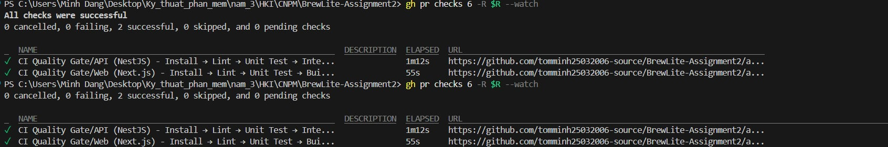
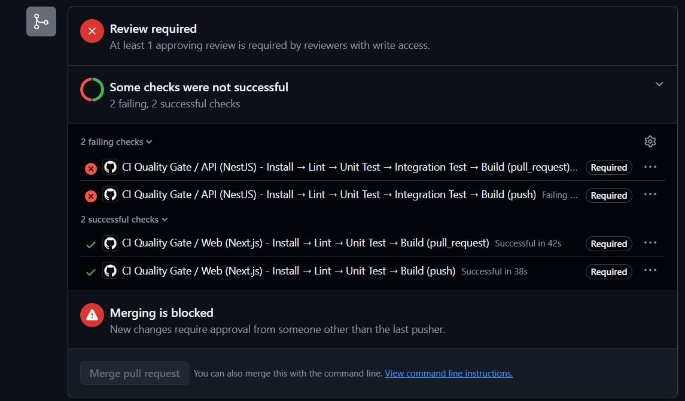
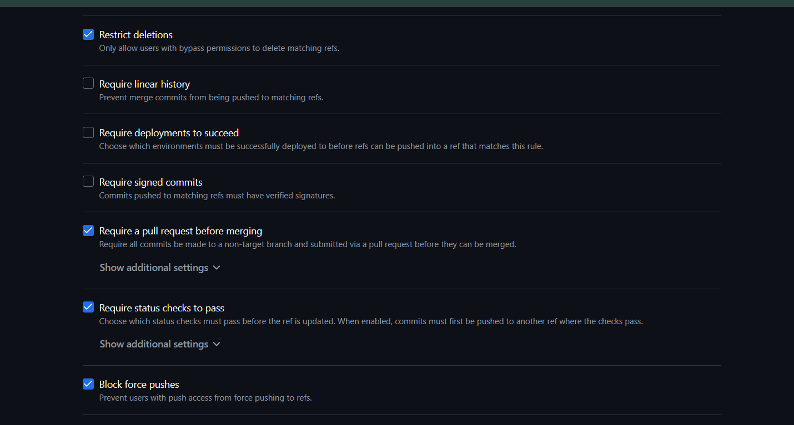
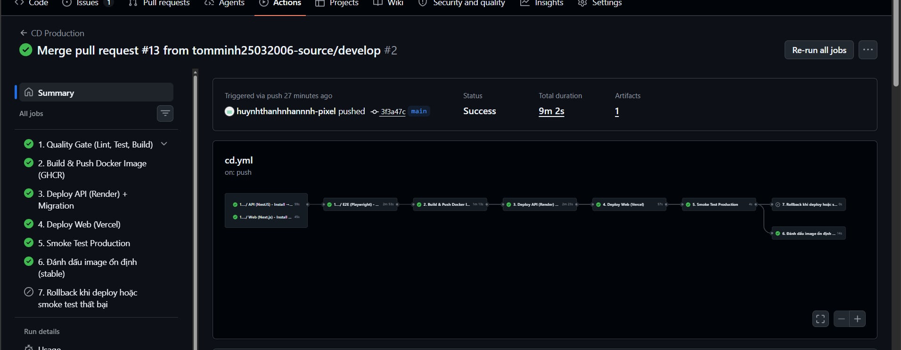

# MINH CHỨNG CONTINUOUS INTEGRATION (CI EVIDENCE)
## DỰ ÁN: BREWLITE – CASHLESS COFFEE ORDERING SYSTEM
> **Mã tài liệu:** `QA-DOC-01` | **Phiên bản:** VER 1.1
> **Thuộc nhiệm vụ:** Task 4.4 – Continuous Integration

---

## 1. PIPELINE CI

Tệp: [`.github/workflows/ci.yml`](../.github/workflows/ci.yml). Chạy tự động khi mở/cập nhật pull request vào `main` hoặc `develop`, và khi push lên `develop`, `feature/**`. Push lên `main` chạy CI thông qua `cd.yml` (job quality gate) nên không kích hoạt lần thứ hai.

| Job | Các bước |
| :--- | :--- |
| `api` | Install → **Lint** (ESLint) → **Unit Test** (Jest) → Integration Test (supertest + PostgreSQL service) → **Build** |
| `web` | Install → **Lint** (`next lint`) → **Unit Test** (Jest + Testing Library) → **Build** |
| `e2e` | Chạy sau khi `api` và `web` pass: `docker compose up` → Playwright E2E-T01, E2E-T02 |

**Chặn merge:** nhánh `main` và `develop` bật *Branch protection* → *Require status checks to pass before merging* với các check `api`, `web`, `e2e`. Pull request có lint, test hoặc build thất bại sẽ không merge được.

---

## 2. MINH CHỨNG TRÊN GITHUB

| Minh chứng | Link pull request / workflow run | Ảnh chụp |
| :--- | :--- | :--- |
| Pipeline **thành công** | [PR #6](https://github.com/tomminh25032006-source/BrewLite-Assignment2/pull/6) – [Actions run](https://github.com/tomminh25032006-source/BrewLite-Assignment2/actions/runs/43585301996) |  |
| Pipeline **phát hiện lỗi** (merge bị chặn) | [PR #7](https://github.com/tomminh25032006-source/BrewLite-Assignment2/pull/7) – [Actions run](https://github.com/tomminh25032006-source/BrewLite-Assignment2/actions/runs/43588714034) |  |
| Cấu hình bảo vệ nhánh (ruleset `bao-ve-develop-main`) | Settings → Rules → Rulesets |  |
| Pipeline **CD** lên production (đủ 6 giai đoạn, rollback bỏ qua) | [PR #13](https://github.com/tomminh25032006-source/BrewLite-Assignment2/pull/13) – [Actions run](https://github.com/tomminh25032006-source/BrewLite-Assignment2/actions/runs/43612279894) |  |

Cách tạo lần chạy lỗi: nhánh `feature/ci-fail-demo` sửa assertion `toHaveLength(1)` → `toHaveLength(99)` trong `apps/api/src/modules/products/products.service.spec.ts`, mở PR #7 vào `develop`. Job API báo đỏ ở bước *Unit Test*, nút *Merge* bị khóa vì ruleset bắt buộc 2 check API và Web pass. Sau khi chụp ảnh, PR được đóng, không merge.

Ruleset `bao-ve-develop-main` áp cho `develop` và `main`: bắt buộc pull request có 1 người duyệt (người duyệt khác người push cuối), bắt buộc 3 check `API (NestJS) …`, `Web (Next.js) …` và `E2E (Playwright) …` pass (E2E được thêm sau Sprint 2), chỉ cho merge commit, cấm force-push và xóa nhánh, không ai được bỏ qua (kể cả chủ repo).

---

## 3. KẾT QUẢ CHẠY CÁC BƯỚC CI Ở LOCAL

Các lệnh dưới đây giống hệt các bước trong `ci.yml`, chạy trên máy lập trình viên ngày 13/11/2026 (sau khi thêm API kiểm tra mã giảm giá):

```text
apps/api  $ npm run lint                → 0 lỗi
apps/api  $ npm test                    → Test Suites: 6 passed, Tests: 35 passed
apps/api  $ npm run test:integration    → Test Suites: 2 passed, Tests: 24 passed
apps/api  $ npm run build               → dist/main.js, dist-seed/seed.js
apps/web  $ npm run lint                → 0 lỗi, 0 warning
apps/web  $ npm test                    → Test Suites: 2 passed, Tests: 7 passed
apps/web  $ npm run build               → 9 route build thành công
root      $ docker compose up --build   → api healthy, web 200
root      $ npm run test:e2e            → 2 passed (E2E-T01, E2E-T02)
```
