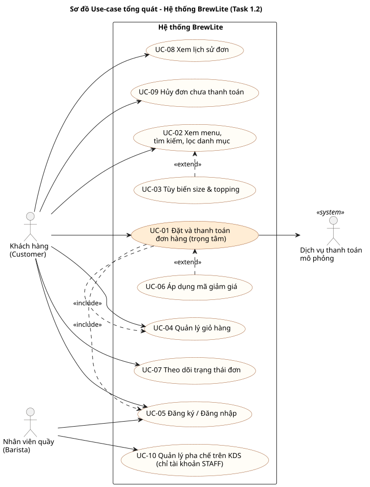

# ĐẶC TẢ YÊU CẦU PHẦN MỀM RÚT GỌN (SOFTWARE REQUIREMENTS SPECIFICATION - SRS)
## DỰ ÁN: BREWLITE – CASHLESS COFFEE ORDERING SYSTEM
> **Mã tài liệu:** `REQ-DOC-02` | **Phiên bản:** VER 1.1  
> **Thuộc nhiệm vụ:** Task 1.2 – Yêu cầu chức năng và phi chức năng (Assignment 2)  
> **Môn học:** Công nghệ Phần mềm — Khoa CNTT, Trường Đại học Sài Gòn (SGU)  
> **Tài liệu liên quan:** [`context-and-scope.md`](./context-and-scope.md), [`user-stories.md`](./user-stories.md), [`use-case-checkout.md`](./use-case-checkout.md)

---

## 1. TỔNG QUAN HỆ THỐNG USE-CASE TỔNG QUÁT

Hệ thống phân tách quyền hạn rõ ràng giữa ba tác nhân chính:
1. **Khách hàng (Customer):** Tác nhân người dùng cuối thực hiện quy trình chọn món, đặt hàng và thanh toán. Tài khoản vai trò `CUSTOMER`.
2. **Nhân viên Quầy / Pha chế (Barista):** Tác nhân vận hành quầy tiếp nhận và cập nhật tiến trình chế biến. Tài khoản vai trò `STAFF`.
3. **Dịch vụ thanh toán mô phỏng (Payment Service):** Hệ thống bên ngoài xác thực và trừ tiền không tiền mặt (mô phỏng MoMo, VNPay, Thẻ).

### Sơ đồ Use-Case Tổng quát (Use-Case Diagram)

Nguồn: [`diagrams/use-case-overview.puml`](../diagrams/use-case-overview.puml)

| Mã | Use-case | Tác nhân | Yêu cầu liên quan |
| :---: | :--- | :--- | :--- |
| **UC-01** | Đặt và thanh toán đơn hàng (**use-case trọng tâm**, đặc tả tại [`use-case-checkout.md`](./use-case-checkout.md)) | Khách hàng, Dịch vụ thanh toán | FR-05, FR-06, FR-07 |
| UC-02 | Xem menu, tìm kiếm, lọc danh mục | Khách hàng | FR-01 |
| UC-03 | Tùy biến size & topping (`<<extend>>` UC-02) | Khách hàng | FR-02 |
| UC-04 | Quản lý giỏ hàng (`<<include>>` từ UC-01) | Khách hàng | FR-03 |
| UC-05 | Đăng ký / Đăng nhập (`<<include>>` từ UC-01) | Khách hàng, Barista | FR-04 |
| UC-06 | Áp dụng mã giảm giá (`<<extend>>` UC-01) | Khách hàng | FR-09 |
| UC-07 | Theo dõi trạng thái đơn | Khách hàng | FR-07 |
| UC-08 | Xem lịch sử đơn | Khách hàng | FR-10 |
| UC-09 | Hủy đơn chưa thanh toán | Khách hàng | FR-11 |
| UC-10 | Quản lý pha chế trên màn hình KDS | Barista | FR-08 |

Mỗi yêu cầu chức năng tương ứng với một user story `US-xx` cùng số (ví dụ FR-01 ↔ US-01), xem [`user-stories.md`](./user-stories.md).

---

## 2. DANH MỤC YÊU CẦU CHỨC NĂNG (FUNCTIONAL REQUIREMENTS - FR)

Tất cả các yêu cầu chức năng được định danh chuẩn $FR-xx$, gán mức độ ưu tiên theo mô hình **MoSCoW** (*Must have*, *Should have*, *Could have*, *Won't have*) và đi kèm **Tiêu chí chấp nhận (Acceptance Criteria - AC)** có thể kiểm thử tự động hoặc bán tự động:

| Mã FR | Tên Yêu Cầu Chức Năng | Mức Ưu Tiên | Mô Tả Nghiệp Vụ Chi Tiết | Tiêu Chí Chấp Nhận (Acceptance Criteria - AC) |
| :---: | :--- | :---: | :--- | :--- |
| **FR-01** | Xem thực đơn đồ uống phân loại | **Must** | Hiển thị danh sách đồ uống đang mở bán theo danh mục: *Cà phê* (`COFFEE`), *Trà trái cây* (`TEA`), *Đá xay* (`ICE_BLENDED`). Hỗ trợ tìm kiếm theo tên/mô tả và lọc danh mục. | • API `GET /api/products` trả về mã `200 OK` danh sách sản phẩm gồm: id, name, category, price, imageUrl, stock, sizeOptions, toppingOptions. • `GET /api/products/:id` trả chi tiết một món; ID không tồn tại trả `404`. • Giao diện có skeleton loading khi tải, empty state khi không tìm thấy món và error state có nút thử lại khi API lỗi. |
| **FR-02** | Tùy biến món & tính giá trực tiếp | **Must** | Khách hàng bấm vào món để mở Modal tùy biến: chọn Size theo cấu hình từng món (S: +0đ; M, L: phụ thu riêng của món, ví dụ M +5.000đ/L +10.000đ hoặc M +6.000đ/L +12.000đ), chọn Topping (+5.000đ đến +12.000đ) theo danh sách topping của từng món. Mức đá/đường nằm ngoài phạm vi MVP (FR-12). | • Tổng tiền hiển thị trên nút CTA tự động cập nhật ngay khi thay đổi size hoặc tick chọn topping. • Nút "Thêm vào giỏ" thêm đúng cấu hình đã chọn. • Giá hiển thị bằng đúng giá backend tính cho cùng cấu hình. |
| **FR-03** | Quản trị Giỏ hàng (Client Cart) | **Must** | Giỏ hàng lưu trữ phía client qua Zustand và đồng bộ `LocalStorage`. Cho phép tăng/giảm số lượng, xóa từng món, dọn sạch giỏ. | • Tải lại trang web dữ liệu giỏ hàng vẫn còn nguyên vẹn. • Huy hiệu số lượng trên Navbar nhảy số chính xác. • Tự động tính đúng tổng tiền tạm tính = $\sum (\text{đơn giá} \times \text{số lượng})$. |
| **FR-04** | Xác thực và phân quyền người dùng (Auth JWT) | **Must** | Đăng ký tài khoản (email, họ tên, mật khẩu), Đăng nhập cấp mã token JWT. Mật khẩu bắt buộc băm bằng Bcrypt với Salt $\ge 10$. Tài khoản có vai trò `CUSTOMER` (mặc định khi đăng ký) hoặc `STAFF` (do cửa hàng cấp). | • API `POST /api/auth/register` từ chối nếu email trùng hoặc mật khẩu $< 6$ ký tự; không cho tự gán vai trò. • `POST /api/auth/login` trả về `accessToken` hợp lệ và thông tin người dùng (`role`, `loyaltyPoints`). • API riêng tư gọi không có token trả `401`. |
| **FR-05** | Khởi tạo Đơn hàng (Pending Order) | **Must** | Gửi giỏ hàng lên server, kiểm tra tính toàn vẹn của DTO và tính giá phía backend, kiểm tra tồn kho, tạo bản ghi đơn hàng với trạng thái ban đầu `PENDING`. | • Gọi `POST /api/orders` trả về `201 Created` kèm `orderCode` dạng `ORD-XXXXXX` (6 chữ số) và trạng thái `PENDING`. • Backend tự tính lại giá từ cấu hình món, không tin cậy giá client gửi lên (gửi trường lạ bị `400`). • Số lượng đặt vượt tồn kho trả `409`. |
| **FR-06** | Thanh toán Không tiền mặt Idempotent | **Must** | Thanh toán qua Ví MoMo, VNPay, Thẻ ngân hàng (mô phỏng). Request gửi kèm `Idempotency-Key` (UUIDv4). Thành công chuyển sang `PAID`, trừ kho, dọn sạch giỏ. Lỗi chuyển sang `PAYMENT_FAILED`, giữ giỏ để thử lại. Chỉ chủ đơn được thanh toán đơn của mình. | • `POST /api/payments` thành công trả về `status: SUCCESS`, `orderStatus: PAID`. • Gửi 2 lần cùng một `Idempotency-Key` chỉ thực hiện thanh toán 1 lần, lần 2 trả cờ `idempotentReplay: true`. • Nhiều request với key khác nhau cho cùng một đơn: chỉ 1 thành công, các request còn lại `409`/`400`, kho chỉ bị trừ một lần. • Key đã dùng cho đơn khác trả `409`. • Khóa lạc quan (Optimistic locking) trừ đúng số tồn kho; lỗi giữa chừng thì rollback toàn bộ. |
| **FR-07** | Xác nhận & Theo dõi Đơn hàng | **Must** | Hiển thị màn hình thành công kèm mã đơn `#ORD-XXXXXX`, thanh đo tiến trình trạng thái trực quan từ `Đã nhận đơn` $\rightarrow$ `Đã thanh toán` $\rightarrow$ `Đang pha chế` $\rightarrow$ `Sẵn sàng` $\rightarrow$ `Hoàn thành`. | • Chủ đơn truy cập `/orders/:id` xem được chi tiết từng món và trạng thái mới nhất; trang tự tải lại trạng thái (tối đa 5 giây) cho tới khi đơn kết thúc. • Người khác truy cập đơn không phải của mình nhận `404`. |
| **FR-08** | Điều phối Quầy pha chế (Barista KDS) | **Should** | Màn hình riêng tại `/staff`, chỉ tài khoản `STAFF` sử dụng: nhận đơn đã thanh toán (`PAID`), bấm chuyển `PREPARING` $\rightarrow$ `READY` $\rightarrow$ `COMPLETED`. | • `GET /api/orders` và `PATCH /api/orders/:id/status` không có token trả `401`, token khách hàng trả `403`. • `PATCH` chỉ nhận `PREPARING`, `READY`, `COMPLETED`, `CANCELLED`; không đặt được `PAID`/`PAYMENT_FAILED` bằng tay (`400`). • Máy trạng thái (State Machine) chặn nhảy cóc trạng thái (`400`). • Nhân viên hủy đơn đã `PAID`: hoàn lại tồn kho các món và thu hồi điểm đã cộng (ghi `LoyaltyTransaction` số âm); hủy lại lần nữa bị chặn (`400`). |
| **FR-09** | Khuyến mãi & Tích điểm thành viên | **Should** | Nhập mã coupon giảm giá (`BREW10` giảm 10% tối đa 30.000đ cho đơn từ 50.000đ; `BREWNEW` giảm 15.000đ). Tự động tích lũy điểm loyalty: 10.000đ = 1 điểm sau khi đơn chuyển `PAID`. | • `GET /api/promotions/:code?subtotal=` trả số tiền giảm do backend tính; giỏ hàng và checkout hiển thị đúng số này (web không tự tính). • Kiểm tra điều kiện đơn tối thiểu, tính giảm giá chính xác; mã không tồn tại/hết hạn hoặc chưa đủ giá trị tối thiểu trả `400`. • Tài khoản người dùng được cộng điểm thưởng và ghi `LoyaltyTransaction` sau thanh toán. |
| **FR-10** | Lịch sử Đơn hàng Cá nhân | **Must** | Khách hàng tra cứu danh sách các đơn hàng đã từng đặt qua API `GET /api/orders/me` và xem lại hóa đơn điện tử. | • Danh sách chỉ gồm đơn của chính khách, mới nhất lên đầu. • Phân loại rõ ràng trạng thái đơn (Chờ thanh toán, Đã thanh toán, Đã hủy…). |
| **FR-11** | Hủy đơn chưa thanh toán | **Should** | Khi thanh toán thất bại hoặc khách đổi ý trước khi thanh toán, khách tự hủy đơn của mình; giỏ hàng vẫn được giữ để đặt lại. | • `POST /api/orders/:id/cancel` chuyển đơn `PENDING`/`PAYMENT_FAILED` của chính khách sang `CANCELLED`. • Đơn đã `PAID` trở đi trả `400`; đơn của người khác trả `404`. • Đơn đã hủy không thanh toán được nữa (`400`). |
| **FR-12** | Chọn mức đá và lượng đường | **Won't** (phiên bản này) | Cho khách chọn mức đá (0%/50%/100%) và lượng đường cho từng món. | Không hiện thực trong Assignment 2; ghi nhận ở phạm vi mở rộng (`context-and-scope.md` §3.2). |
| **FR-13** | Hoàn tiền tự động khi hủy đơn đã thanh toán | **Won't** (phiên bản này) | Hoàn tiền qua cổng thanh toán khi nhân viên quầy hủy đơn đã `PAID` (tồn kho và điểm đã được hoàn/thu hồi theo FR-08). | Không hiện thực vì hệ thống chỉ dùng thanh toán mô phỏng (`context-and-scope.md` §3.3). |

---

## 3. DANH MỤC YÊU CẦU PHI CHỨC NĂNG (NON-FUNCTIONAL REQUIREMENTS - NFR)

| Mã NFR | Nhóm Đặc Tính | Tiêu Chuẩn Kỹ Thuật Chi Tiết | Cách Thức Kiểm Chứng (Verification Method) |
| :---: | :--- | :--- | :--- |
| **NFR-01** | **Hiệu năng (Performance)** | • Thời gian phản hồi của tất cả các REST API chính (Menu, Order, Payment) đạt **dưới 500ms** đối với dữ liệu thử nghiệm. • Frontend Next.js đạt điểm Core Web Vitals loại Tốt (LCP $< 2.5\text{s}$, INP $< 200\text{ms}$). | Integration test API-T01 đo thời gian `GET /api/products`; đo trang bằng Lighthouse. |
| **NFR-02** | **Bảo mật (Security)** | • Mật khẩu người dùng được băm một chiều bằng `bcryptjs` với salt round $\ge 10$. • Xác thực phiên bằng JSON Web Token (JWT) có thời hạn hết hạn; `JWT_SECRET` chỉ lấy từ biến môi trường. • Phân quyền theo vai trò (`CUSTOMER`/`STAFF`) và kiểm tra chủ đơn: khách chỉ truy cập đơn của mình. • Dữ liệu đầu vào (DTO) được kiểm duyệt bằng `ValidationPipe` (whitelist = true, forbidNonWhitelisted = true) để chống Injection và Mass Assignment. | Integration test API-T04, INT-T01, INT-T03, INT-T12, INT-T14; secret không có trong repository. |
| **NFR-03** | **Khả dụng & Thích ứng (Usability/PWA)** | • Giao diện chuẩn **Mobile-First Responsive**, hiển thị tốt từ điện thoại màn hình nhỏ ($375\text{px}$) đến máy tính bảng và màn hình máy tính ($1920\text{px}$). • Có Web App Manifest (PWA) để thêm vào màn hình chính. • Tương thích tốt trên Chrome, Safari, Edge, Firefox. | E2E chạy trên thiết bị giả lập Pixel 7; kiểm tra thủ công trên Chrome DevTools Device Mode (iPhone SE, iPad). |
| **NFR-04** | **Toàn vẹn Dữ liệu (Reliability & Concurrency)** | • Đảm bảo tính nguyên tố (Atomicity) trong các giao dịch trừ kho và đổi trạng thái. • Khi nhiều khách cùng đặt hàng đồng thời, hệ thống sử dụng **Optimistic Locking** ngăn chặn tình trạng bán vượt tồn kho (overselling) hoặc tồn kho âm. • Một đơn chỉ được thanh toán thành công một lần. | Integration test INT-T08 (rollback), INT-T09 (5 khách, kho 2), INT-T13 (5 request cho cùng một đơn). |
| **NFR-05** | **Khả năng Triển khai (Deployability & DevOps)** | • Toàn bộ hệ thống (Frontend, Backend, Database) được đóng gói qua Dockerfile đa tầng và điều phối bằng Docker Compose. • Pipeline CI chạy Lint, Test và Build cho mọi pull request; pipeline CD build image theo commit SHA, deploy, smoke test và rollback. • Endpoint `GET /api/health` kiểm tra kết nối database. | Khởi chạy thành công chỉ với `docker compose up --build`; pipeline GitHub Actions chạy xanh; API-T00, API-T05. |

---
*Tài liệu SRS được sử dụng làm cơ sở đối chiếu cho việc thiết kế mô hình hóa UML (Task 2) và xây dựng Ma trận truy vết (mục 8 của đề).*
