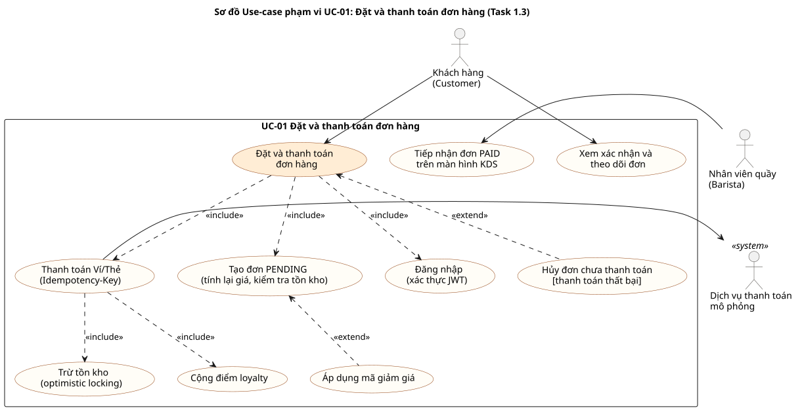

# ĐẶC TẢ CHI TIẾT USE-CASE TRỌNG TÂM: ĐẶT VÀ THANH TOÁN ĐƠN HÀNG
## DỰ ÁN: BREWLITE – CASHLESS COFFEE ORDERING SYSTEM
> **Mã tài liệu:** `UC-SPEC-01` | **Phiên bản:** VER 1.1  
> **Thuộc nhiệm vụ:** Task 1.3 – Đặc tả một use-case trọng tâm (Assignment 2)  
> **Môn học:** Công nghệ Phần mềm — Khoa CNTT, Trường Đại học Sài Gòn (SGU)  

---

## 1. TỔNG QUAN USE-CASE

| Thuộc tính | Chi tiết đặc tả |
| :--- | :--- |
| **Mã Use-case** | **`UC-01`** (trùng mã trong sơ đồ use-case tổng quát của [`srs.md`](./srs.md) và ma trận truy vết) |
| **Tên Use-case** | **Đặt và thanh toán đơn hàng không dùng tiền mặt (Cashless Order & Checkout)** |
| **Tác nhân chính (Primary Actor)** | **Khách hàng (Customer):** Người dùng muốn mua đồ uống và thanh toán điện tử. |
| **Tác nhân hỗ trợ (Secondary Actors)** | **Dịch vụ thanh toán mô phỏng (Payment Service):** Xử lý trừ tiền điện tử. **Nhân viên Quầy (Barista):** Tiếp nhận đơn để chế biến sau khi thanh toán thành công. |
| **Sự kiện kích hoạt (Trigger)** | Khách hàng nhấn nút **"Tiến hành Thanh toán"** tại trang Giỏ hàng (`/cart`). |
| **Mức độ ưu tiên** | **Must Have** (trọng tâm cốt lõi của MVP). |
| **Liên kết mã yêu cầu (Traceability)** | `FR-02`, `FR-03`, `FR-04`, `FR-05`, `FR-06`, `FR-07`, `FR-09`, `FR-11`, `NFR-01`, `NFR-02`, `NFR-04`; user story `US-05`, `US-06`, `US-07`, `US-11`. |
| **Sơ đồ liên quan** | Activity: [`activity-checkout.puml`](../diagrams/activity-checkout.puml) · Sequence: [`sequence-checkout.puml`](../diagrams/sequence-checkout.puml) |

### Sơ đồ Phạm vi Use-Case (Use-Case Diagram)

Nguồn: [`diagrams/use-case-checkout.puml`](../diagrams/use-case-checkout.puml)

---

## 2. TIỀN ĐIỀU KIỆN & HẬU ĐIỀU KIỆN (PRE & POST CONDITIONS)

### 2.1. Tiền điều kiện (Pre-conditions)
1. Giỏ hàng của khách hàng trên giao diện web có **ít nhất 1 sản phẩm** với số lượng $\ge 1$.
2. Toàn bộ các món trong giỏ hàng đều đang mở bán (`isActive = true`).
3. Khách hàng đã đăng nhập tài khoản hợp lệ (sở hữu JWT còn hiệu lực). Nếu chưa đăng nhập, hệ thống kích hoạt luồng đăng nhập (Luồng thay thế A1).

### 2.2. Hậu điều kiện (Post-conditions)
- **Kịch bản thành công (Success Post-conditions):**
  1. Bản ghi Đơn hàng (`Order`) trong CSDL ở trạng thái `PAID`.
  2. Tồn kho các sản phẩm tương ứng được trừ đúng số lượng theo cơ chế Khóa lạc quan (Optimistic Locking).
  3. Bản ghi Giao dịch (`Payment`) được lưu cùng `Idempotency-Key` duy nhất, trạng thái `SUCCESS`.
  4. Tài khoản người dùng được cộng điểm thưởng theo tỷ lệ 10.000đ = 1 điểm và có bản ghi `LoyaltyTransaction`.
  5. Giỏ hàng tại máy khách (`cartStore`) được làm rỗng.
  6. Khách hàng được chuyển sang trang xác nhận đơn (`/orders/:id`) hiển thị mã đơn `#ORD-XXXXXX`.
  7. Đơn hàng hiển thị trên Màn hình Quầy (`/staff`, tài khoản `STAFF`) ở trạng thái chờ pha chế.
- **Kịch bản thất bại (Failure Post-conditions):**
  1. Trạng thái đơn hàng là `PAYMENT_FAILED` (hoặc `CANCELLED` nếu khách chọn hủy đơn).
  2. Tồn kho sản phẩm không bị thay đổi, không có `Payment` thành công, không cộng điểm.
  3. Giỏ hàng của khách hàng **được giữ nguyên vẹn**, không bị xóa.
  4. Thông báo lỗi được hiển thị trên giao diện; khách có thể thanh toán lại hoặc hủy đơn.

---

## 3. LUỒNG NGHIỆP VỤ CHI TIẾT (FLOW OF EVENTS)

### 3.1. Luồng Chính (Main Flow — Happy Path)

| Bước | Hành Động Của Tác Nhân (Actor Action) | Phản Hồi Của Hệ Thống (System Response) |
| :---: | :--- | :--- |
| **1** | Tại trang `/cart`, khách hàng bấm nút **"Tiến hành Thanh toán"**. | Hệ thống kiểm tra phiên đăng nhập. Nếu đã đăng nhập, chuyển sang trang `/checkout`. |
| **2** | Khách hàng kiểm tra tóm tắt đơn hàng. | Hệ thống hiển thị số cốc, mã giảm giá đã áp dụng (nếu có) và tổng tiền cần thanh toán. |
| **3** | Khách hàng chọn phương thức thanh toán: **Ví MoMo**, **VNPay** hoặc **Thẻ ngân hàng**. | Hệ thống đánh dấu phương thức được chọn. |
| **4** | Khách hàng bấm **"Xác nhận trả … đ"**. | Frontend hiển thị trạng thái đang xử lý và khóa nút để tránh bấm nhiều lần. |
| **5** | | Frontend gửi `POST /api/orders` với `{ items: [{ productId, size, toppingIds, qty }], promotionCode }`. Backend kiểm tra JWT, validate DTO, tính lại đơn giá từ cấu hình món, kiểm tra tồn kho và mã giảm giá, lưu đơn `PENDING` và trả `201` kèm `orderCode` (ví dụ `ORD-104271`) và `finalAmount`. |
| **6** | | Frontend so sánh `finalAmount` của server với số tiền khách vừa thấy; nếu khớp, sinh một `Idempotency-Key` (UUID) cho lần thanh toán này và gửi `POST /api/payments` với header `Idempotency-Key` và `{ orderId, method, amount }`. |
| **7** | | Backend kiểm tra đơn thuộc về khách đang đăng nhập, kiểm tra `Idempotency-Key` chưa được dùng và đơn đang ở `PENDING`/`PAYMENT_FAILED`. |
| **8** | | Backend gọi Dịch vụ thanh toán mô phỏng; kết quả `SUCCESS`. |
| **9** | | Backend thực thi một Database Transaction: a) Chuyển đơn sang `PAID` bằng `UPDATE … WHERE status IN ('PENDING','PAYMENT_FAILED')` (khóa dòng đơn hàng). b) Trừ tồn kho từng món theo version (Optimistic Lock). c) Cộng điểm Loyalty và ghi `LoyaltyTransaction`. d) Lưu bản ghi `Payment` kèm `idempotencyKey`. e) Commit và phản hồi `201` `{ status: "SUCCESS", orderStatus: "PAID", loyaltyPointsAdded, … }`. |
| **10** | | Frontend gọi `clearCart()`, cập nhật điểm thưởng, chuyển sang `/orders/:id` hiển thị mã đơn `#ORD-104271` và thanh tiến trình; trang tự tải lại trạng thái định kỳ. |
| **11** | Barista đăng nhập tài khoản `STAFF` và mở `/staff`. | Đơn `#ORD-104271` xuất hiện ở trạng thái `PAID` để nhận pha chế. |

---

### 3.2. Các Luồng Thay Thế (Alternative Flows)

#### A1: Khách hàng chưa đăng nhập tài khoản
Tại **Bước 1**, nếu hệ thống phát hiện khách hàng chưa đăng nhập:
1. Giao diện mở Modal đăng nhập / đăng ký (`AuthModal.tsx`).
2. Khách hàng nhập email và mật khẩu rồi bấm Đăng nhập (hoặc đăng ký tài khoản mới).
3. Hệ thống xác thực, lưu JWT vào LocalStorage và đóng Modal.
4. Giỏ hàng giữ nguyên; hệ thống chuyển sang `/checkout` (quay lại **Bước 2**).

#### A2: Khách hàng nhập mã giảm giá
Trước **Bước 1**, tại trang `/cart`, khách hàng nhập mã (ví dụ `BREW10`) và bấm **"Áp dụng"**:
1. Frontend gọi `GET /api/promotions/:code?subtotal=`; backend kiểm tra mã và điều kiện (đơn từ 50.000đ với `BREW10`), trả số tiền giảm dự kiến để hiển thị. Mã sai hoặc chưa đủ điều kiện → `400`, giao diện báo lỗi. Khi giỏ hàng thay đổi, số tiền giảm được tính lại.
2. Mã được gửi kèm ở **Bước 5**; backend kiểm tra lại mã có tồn tại, còn hạn, đủ giá trị tối thiểu và tính số tiền giảm (10%, tối đa 30.000đ). Mã không hợp lệ → `400`, đơn không được tạo.

#### A3: Số tiền server tính khác số tiền khách đã thấy
Tại **Bước 6**, nếu `finalAmount` của đơn vừa tạo khác số tiền hiển thị (ví dụ giá món vừa thay đổi):
1. Frontend **không** gửi yêu cầu thanh toán, hiển thị số tiền mới và yêu cầu khách xác nhận lại.
2. Khách bấm xác nhận lần nữa → tiếp tục **Bước 6** với đúng đơn đã tạo và số tiền của server.

---

### 3.3. Các Luồng Ngoại Lệ (Exception Flows)

#### E1: Sản phẩm hết hàng (Overselling)
- Tại **Bước 5**, nếu số lượng đặt lớn hơn tồn kho: backend trả `409 Conflict`, không tạo đơn; frontend hiển thị lỗi, giỏ hàng giữ nguyên.
- Tại **Bước 9b**, nếu món đã bị đơn khác mua hết sau khi tạo đơn (`stock < qty` hoặc xung đột version liên tục):
  1. Backend rollback toàn bộ transaction (đơn không chuyển `PAID`, không ghi `Payment`, không cộng điểm) và trả `409`.
  2. Frontend hiển thị thông báo lỗi; giỏ hàng giữ nguyên để khách điều chỉnh món.

#### E2: Thanh toán thất bại hoặc bị từ chối
Tại **Bước 8**, dịch vụ thanh toán trả kết quả thất bại:
1. Backend chuyển đơn sang `PAYMENT_FAILED` và lưu `Payment` trạng thái `FAILED` (trong một transaction).
2. Phản hồi `{ status: "FAILED", orderStatus: "PAYMENT_FAILED" }`.
3. Frontend giữ nguyên giỏ hàng, hiển thị thông báo thanh toán không thành công kèm nút **"Hủy đơn #ORD-…"**.
4. Nếu khách bấm xác nhận thanh toán lại: hệ thống sinh `Idempotency-Key` mới và quay lại **Bước 6** với cùng đơn hàng.
5. Nếu khách bấm **"Hủy đơn"**: frontend gọi `POST /api/orders/:id/cancel`, đơn chuyển sang `CANCELLED` (UC-09), giỏ hàng vẫn giữ để đặt lại.

#### E3: Khách hàng gửi lại cùng yêu cầu thanh toán (Idempotency Replay)
Tại **Bước 6**, do mạng chập chờn, request thanh toán được gửi lại với **cùng** `Idempotency-Key`:
1. Request đầu được xử lý bình thường và lưu key vào bảng `Payment`.
2. Request sau: backend tìm thấy key đã tồn tại → **không** gọi dịch vụ thanh toán, **không** trừ kho hay cộng điểm lần nữa, trả lại kết quả cũ kèm `idempotentReplay: true`.

#### E4: Nhiều yêu cầu thanh toán cho cùng một đơn với key khác nhau
Ví dụ khách mở đơn ở hai tab và bấm thanh toán cùng lúc:
1. Giao dịch đầu tiên khóa dòng đơn hàng ở **Bước 9a** và hoàn tất.
2. Giao dịch đến sau không chuyển được trạng thái (đơn đã `PAID`) → rollback, trả `409` (hoặc `400` nếu đọc thấy đơn đã `PAID` ở **Bước 7**). Khách chỉ bị trừ tiền một lần, kho chỉ bị trừ một lần.

#### E5: Idempotency-Key đã được dùng cho đơn khác
Tại **Bước 7**, nếu key đã gắn với một đơn hàng khác: backend trả `409`, không trả lại kết quả của đơn kia. Frontend sinh key mới khi khách thanh toán lại.

#### E6: Phiên đăng nhập hết hạn hoặc đơn không thuộc về khách
- JWT hết hạn hoặc không hợp lệ ở **Bước 5–7** → `401`; khách đăng nhập lại (A1).
- Đơn hàng không thuộc tài khoản đang đăng nhập → `404`, như đơn không tồn tại.

---

## 4. TIÊU CHÍ NGHIỆM THU RÕ RÀNG (ACCEPTANCE CRITERIA)

Dựa trên đặc tả use-case này, người đánh giá có thể kiểm chứng rõ ràng những gì hệ thống làm và không làm (mã test trong ngoặc, xem [`traceability-matrix.md`](../traceability-matrix.md)):

1. **Hệ thống PHẢI LÀM:**
   - Cho phép chọn các kênh thanh toán không tiền mặt (MoMo, VNPay, Card) (E2E-T01).
   - Tính lại giá ở backend, không dùng giá client gửi lên (INT-T02, INT-T03).
   - Bắt buộc có `Idempotency-Key` trong mỗi yêu cầu thanh toán (UT-T06).
   - Chặn mọi nỗ lực trừ tiền lặp lại: cùng key (INT-T06), nhiều key cho cùng một đơn (INT-T13), key của đơn khác (INT-T15).
   - Bảo đảm tính nguyên tố: trừ kho lỗi thì không ghi nhận thanh toán (INT-T08); không bán vượt tồn kho (INT-T09).
   - Cho phép thanh toán lại sau khi thất bại (INT-T07) hoặc hủy đơn chưa thanh toán (INT-T16).
   - Cung cấp mã đơn hàng `#ORD-XXXXXX` cho khách đối chiếu tại quầy (E2E-T01).
2. **Hệ thống KHÔNG LÀM:**
   - Không cho tạo đơn hoặc thanh toán khi chưa xác thực JWT (INT-T01) hoặc khi giỏ hàng trống (INT-T03).
   - Không cho khách xem, thanh toán hay hủy đơn của người khác (INT-T14).
   - Không xóa giỏ hàng nếu giao dịch thanh toán thất bại.
   - Không cho thanh toán tiền mặt truyền thống (định hướng hệ thống là Cashless) và không hoàn tiền tự động (FR-13).

---
*Tài liệu đặc tả Use-Case này là nguồn cơ sở trực tiếp để mô hình hóa Sequence Diagram và Activity Diagram trong Task 2 và viết Integration/E2E Test trong Task 5.*
